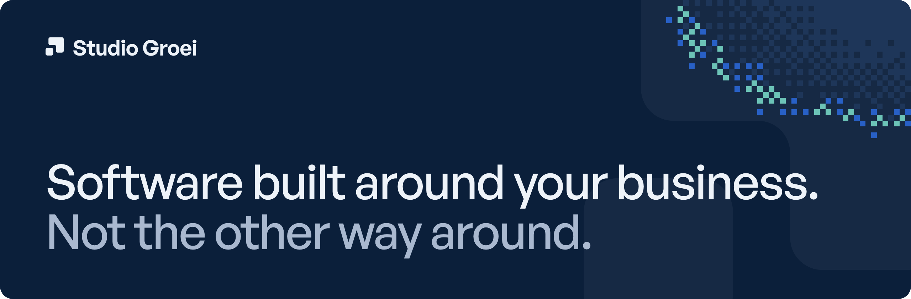
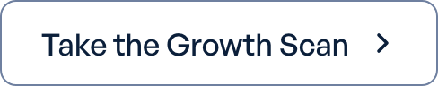
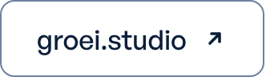
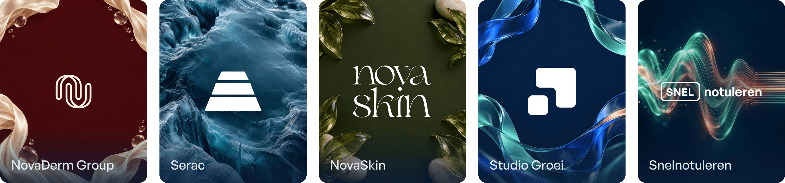

 

We map how your team works and build the software, integrations and portals that fit it. Custom software is the starting point. Design, integrations and everything else follow the work you want to improve.

  <a href="https://groei.studio/en/contact"><picture><source media="(prefers-color-scheme: dark)" srcset="assets/kas-btn-call-dark.png"></picture></a>&nbsp;
  <a href="https://groei.studio/en/growth-scan"><picture><source media="(prefers-color-scheme: dark)" srcset="assets/kas-btn-scan-dark.png"></picture></a>&nbsp;
  <a href="https://groei.studio/en"><picture><source media="(prefers-color-scheme: dark)" srcset="assets/kas-btn-site-dark.png"></picture></a>

 

### What we build

- **Custom software.** Internal tools and platforms that follow your process, including the exceptions off-the-shelf software cannot handle.
- **Integrations & automation.** Let data flow between your systems and take repetitive manual tasks out of your workflow. With AI where it helps.
- **Websites & client portals.** A website that makes your offer clear, or a portal where your customers can take care of things themselves.
- **Custom e-commerce.** An ordering process that fits your customers and operations, connected to stock, payments and accounting.
- **Interfaces for your team.** Screens designed with the people who use them. The right information and actions in the right place.
- **Branding.** A recognisable identity for your business and product. We turn who you are into a brand that also works in your software.

### How we work

**Built as a project. Supported for the long term.** We build software around your business on a project basis. A retainer or maintenance fee covers the ongoing care and support. We agree the scope, price and responsibilities upfront.

1. **The project.** We turn your processes into working software. For each phase, we define what we build, what it costs and how you review the result. Your team tests with everyday tasks, and you sign off each phase yourself.
2. **Maintenance and support.** After delivery, we stay involved through a retainer or maintenance fee. We agree what maintenance and support it includes, and how we handle further improvements.

**Straight to the makers.** You talk to the people who design and build your software, without an account manager in between.

### Selected work

| Project | What it is |
| --- | --- |
| [NovaDerm Group](https://groei.studio/en/projects/novaderm) | B2B orders connected to business operations |
| [Serac](https://groei.studio/en/projects/serac) | AI support within the ServiceNow workflow |
| [NovaSkin](https://groei.studio/en/projects/novaskin) | From skincare advice to a suitable order |
| [Studio Groei](https://groei.studio/en/projects/studio-groei) | The platform where clients follow their project and sign off each phase |
| [Snelnotuleren](https://groei.studio/en/projects/snelnotuleren) | Audio into meeting minutes, with AI |

### The team

[**Niels van der Werf**](https://groei.studio/en/team/niels-van-der-werf), co-founder & tech lead 
[**Joey Giljam**](https://groei.studio/en/team/joey-giljam), co-founder & design lead

 

